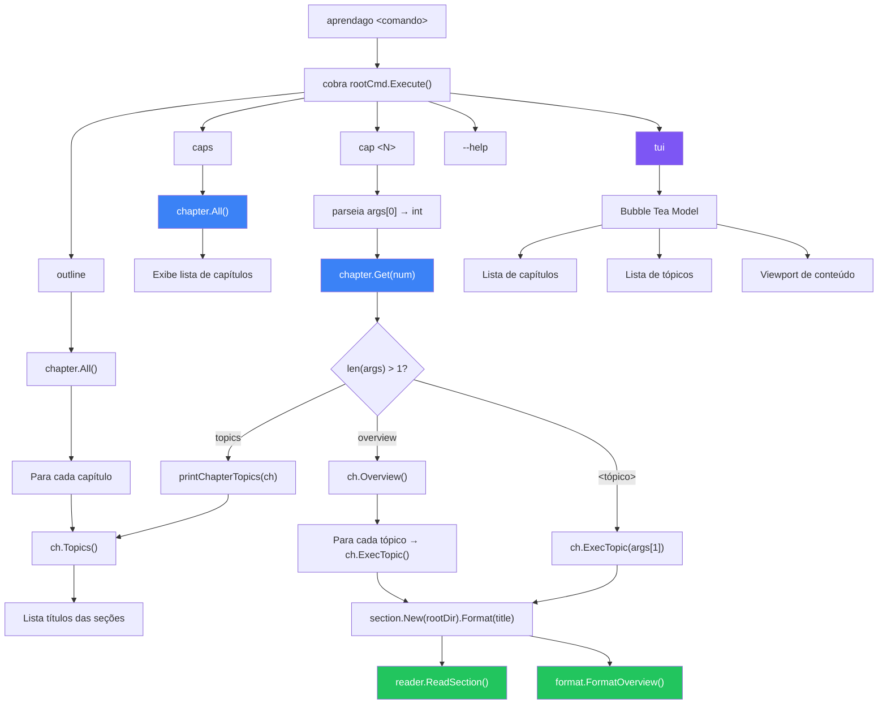
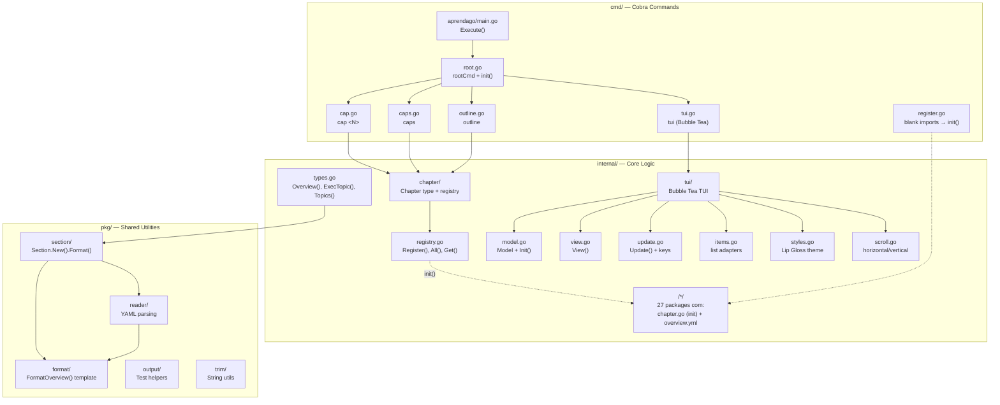

# Aprenda Go

[](https://goreportcard.com/report/github.com/fabianoflorentino/aprendago) [](https://github.com/fabianoflorentino/aprendago/actions/workflows/ci.yml) [](https://github.com/fabianoflorentino/aprendago/actions/workflows/codeql.yml) [](https://github.com/fabianoflorentino/aprendago/actions/workflows/trivy.yml) [](https://github.com/fabianoflorentino/aprendago/actions/workflows/dependabot/dependabot-updates)

[](https://github.com/fabianoflorentino/aprendago/actions/workflows/linux.yml) [](https://github.com/fabianoflorentino/aprendago/actions/workflows/macos.yml) [](https://github.com/fabianoflorentino/aprendago/actions/workflows/windows.yml)

[](https://pkg.go.dev/github.com/fabianoflorentino/aprendago)
[](https://hub.docker.com/r/fabianoflorentino/aprendago/tags)

## Origem do Projeto

Curso de Go para iniciantes. Aprenda Go é um curso abrangente que ensina desde o básico até tópicos avançados da linguagem Go. Ministrado por [Ellen Körbes](https://www.linkedin.com/in/vkorbes/), uma entusiasta da linguagem, o curso é gratuito e está disponível no YouTube e no GitHub. Acesse a playlist no YouTube [aqui](https://youtube.com/playlist?list=PLCKpcjBB_VlBsxJ9IseNxFllf-UFEXOdg&si=_JIbmByhwYvHdJAr) e o repositório no GitHub [aqui](https://github.com/vkorbes/aprendago).

## Objetivo

Este projeto tem como objetivo criar um CLI para facilitar a navegação e o acesso ao conteúdo do curso Aprenda Go. Desenvolvido em Go, utiliza [Cobra](https://github.com/spf13/cobra) para comandos CLI e [Bubble Tea](https://github.com/charmbracelet/bubbletea) com [Lip Gloss](https://github.com/charmbracelet/lipgloss) para uma TUI interativa com navegação por capítulos e tópicos. O CLI esta sendo desenvolvido como parte da prática de estudos da linguagem Go.

## Afim de contribuir?

Se você deseja contribuir com o projeto, fique à vontade para abrir uma [issue](https://github.com/fabianoflorentino/aprendago/issues) ou submeter um [pull request](https://github.com/fabianoflorentino/aprendago/pulls). Sua contribuição é muito bem-vinda!

## Montando o Ambiente de Desenvolvimento

Faça o clone do repositório:

```shell
git clone https://github.com/fabianoflorentino/aprendago.git
```

### Construa a imagem Docker

```shell
docker compose build --no-cache
```

### Inicie o container

```shell
docker compose up -d
```

### Parando o container

```shell
docker compose down
```

## Usando o CLI

O CLI oferece quatro subcomandos principais:

### `aprendago caps` — Lista capítulos disponíveis

```shell
go run cmd/aprendago/main.go caps
```

```
Capítulos do Curso
  aprendago cap 1 topics    Visão Geral do Curso
  aprendago cap 2 topics    Variáveis, Valores e Tipos
  aprendago cap 3 topics    Exercícios Ninja: Nível 1
  ...
```

### `aprendago cap <N>` — Acessa um capítulo

```shell
go run cmd/aprendago/main.go cap 1 topics
```

```
Visão Geral do Curso
  Bem-vindo!
  Por que Go?
  Sucesso
  Recursos
  Como esse curso funciona
```

Subcomandos do `cap`:
| Uso | Descrição |
|---|---|
| `aprendago cap <N>` | Mostra o overview do capítulo |
| `aprendago cap <N> topics` | Lista os tópicos do capítulo |
| `aprendago cap <N> overview` | Mostra o conteúdo completo do capítulo |
| `aprendago cap <N> "<tópico>"` | Mostra um tópico específico |

### `aprendago outline` — Outline completo do curso

```shell
go run cmd/aprendago/main.go outline
```

```bash
Visão Geral do Curso
  Bem-vindo!
  Por que Go?
  ...
```

### `aprendago tui` — Interface interativa

```shell
go run cmd/aprendago/main.go tui
```

A TUI oferece uma interface split-pane com:
- Lista de capítulos (esquerda)
- Lista de tópicos (centro)
- Visualização de conteúdo (direita)

**Atalhos:**
| Tecla | Ação |
|---|---|
| `↑↓` | Navegar entre itens |
| `Enter` | Selecionar capítulo/tópico |
| `/` | Fuzzy search |
| `Esc` | Voltar |
| `q` | Sair |
| Mouse scroll | Rolar conteúdo |

### `aprendago --help` — Ajuda

```shell
go run cmd/aprendago/main.go --help
```

```bash
CLI para o curso Aprenda Go

Usage:
  aprendago [flags]
  aprendago [command]

Available Commands:
  cap         Acessa um capítulo do curso
  caps        Lista capítulos disponíveis
  completion  Generate the autocompletion script for the specified shell
  help        Help about any command
  outline     Exibe o outline completo do curso
  tui         Interface interativa com Bubble Tea

Flags:
  -h, --help   help for aprendago

Use "aprendago [command] --help" for more information about a command.
```

## Fluxo de Funcionamento



## Arquitetura do Código



## Estrutura do Projeto

```shell
.
├── cmd/                    # CLI entrypoint and cobra commands
│   ├── aprendago/main.go
│   ├── cap.go              # aprendago cap <N> [topics|overview|<topic>]
│   ├── caps.go             # aprendago caps
│   ├── outline.go          # aprendago outline
│   ├── register.go         # blank imports for chapter self-registration
│   ├── root.go             # cobra root command
│   └── tui.go              # aprendago tui (Bubble Tea)
├── internal/
│   ├── chapter/            # Chapter type, registry, and helpers
│   ├── tui/                # Bubble Tea TUI (model, view, update, styles, scroll)
│   └── <capitulo>/         # 27 chapter packages (overview.yml + chapter.go)
├── pkg/                    # Shared utilities
│   ├── format/             # Output formatting (overview, questionnaire)
│   ├── output/             # Output helpers
│   ├── reader/             # YAML overview reader
│   ├── section/            # Section formatting from overview.yml
│   └── trim/               # String trimming
├── Makefile
├── Dockerfile
├── docker-compose.yml
└── README.md
```

## Licença

Este projeto é licenciado sob a licença MIT. Consulte o arquivo [LICENSE](LICENSE) para obter detalhes.
