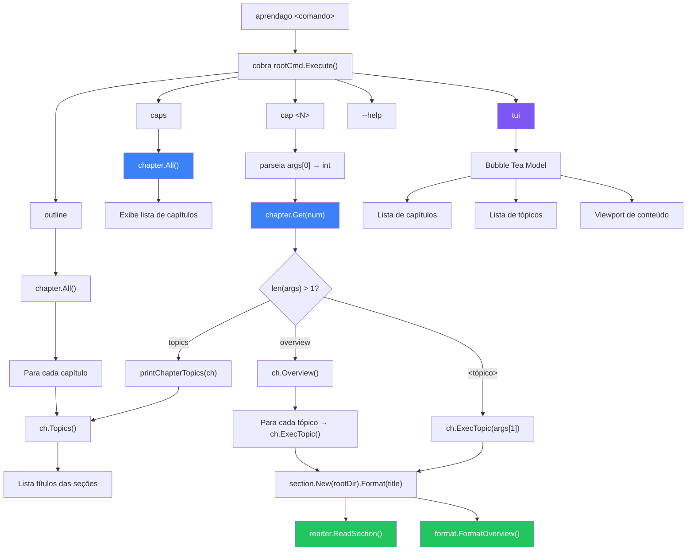

# Plano de Modernização: aprendago

---

## Roadmap de Melhorias

### ✅ Migração Arquitetural (Completa)

- [x] Cobra CLI framework (comandos `cap`, `caps`, `outline`)
- [x] Struct `Chapter` concreto com registry (`internal/chapter/`)
- [x] Registro via `init()` em todos os 27 capítulos
- [x] Remoção de `internal/menu/` e pacotes legados (`base_content`, `topic`, `logger`)
- [x] Remoção de boilerplate legado (`topics.go`, `menu.go`, `help.go`, `static_content.go`)
- [x] Makefile com targets completos
- [x] Dockerfile com estágios otimizados
- [x] CI/CD (build, CodeQL, Trivy, Dependabot)

### ✅ TUI Interativa (Implementada)

- [x] Bubble Tea + Lip Gloss para interface split-pane
- [x] Navegação por capítulos e tópicos com setas
- [x] Fuzzy search com `/`
- [x] Scroll horizontal/vertical com scrollbars customizadas
- [x] Carregamento assíncrono de conteúdo
- [x] Suporte a mouse (scroll wheel)

### 🔲 Experiência TUI — Melhorias

- [ ] **Markdown rendering** com `charmbracelet/glamour` — renderizar headings, bold, italic no terminal
- [ ] **Syntax highlighting** em blocos de código Go (via `chroma` ou `glamour`)
- [ ] **Help overlay** com `?` — modal com todos os atalhos de teclado
- [ ] **Themes** (`dark`/`light`) — toggle com `t` no TUI ou flag `--theme`
- [ ] **Painéis redimensionáveis** — ajustar proporção esquerda/direita com mouse ou teclado

### 🔲 Produtividade

- [ ] **Busca global** com `Ctrl+F` — buscar texto em qualquer `overview.yml` de todos os capítulos
- [ ] **Bookmarks / Favoritos** — marcar tópicos com `b`, persistir em `~/.config/aprendago/bookmarks.json`
- [ ] **Progress tracking** — marcar tópicos visualizados, exibir ✓ ou % no TUI
- [ ] **Histórico de navegação** — comando `aprendago recent` ou atalho `r` no TUI
- [ ] **Output formatado** — flags `--json` e `--plain` nos comandos CLI para saída machine-readable

### 🔲 Exercícios Interativos

- [ ] **Quiz integrado no TUI** — questionário com seleção de opções via setas (substituir `fmt.Scan`)
- [ ] **Validação de código** — modo interativo onde usuário tenta resolver e sistema compara com resposta
- [ ] **Go Playground** — atalho `p` no TUI para abrir link do playground no browser

### 🔲 Infraestrutura

- [ ] **Shell completion customizado** — completar números de capítulos e nomes de tópicos
- [ ] **Testes de integração** — testar comandos CLI end-to-end com `cmdtest`
- [ ] **Benchmark de performance** — medir tempo de carregamento de conteúdo

---

## Estado Atual da Arquitetura (Pós-Migração)

### Estrutura do Projeto

```
cmd/
  aprendago/main.go       → cobra.Execute()
  root.go                 → cobra.Command raiz
  cap.go                  → aprendago cap <N> [topics|overview|<topic>]
  caps.go                 → aprendago caps
  outline.go              → aprendago outline
  tui.go                  → aprendago tui (Bubble Tea)
  register.go             → blank imports → init()

internal/
  chapter/
    types.go              → struct Chapter + Overview(), ExecTopic(), Topics()
    registry.go           → Register(), All(), Get()
  tui/
    model.go, view.go, update.go, items.go, styles.go, scroll.go
  <chapter>/
    chapter.go            → func init() { chapter.Register(&chapter.Chapter{...}) }
    overview.yml          → conteudo do capitulo
    examples.go           → exemplos de codigo (se houver)
    resolution_*.go       → resolucao de exercicios (se houver)

pkg/
  format/                 → templates de output (overview, questionnaire, resolucao)
  section/                → Section.New().Format()
  reader/                 → leitura de YAML
  output/                 → helpers de output
  trim/                   → string trimming
```

### Diagrama de Fluxo Atual



---

## Sumário

1. [Roadmap de Melhorias](#roadmap-de-melhorias) (acima)
2. [Estado Atual da Arquitetura](#estado-atual-da-arquitetura-pós-migração) (acima)
3. [Formato de Conteúdo: YAML vs Markdown](#1-formato-de-conteudo-yaml-vs-markdown)
4. [Prova de Conceito: Capítulo 1](#2-prova-de-conceito-capitulo-1)
5. [Resumo Executivo](#3-resumo-executivo)

---

## 1. Formato de Conteúdo: YAML vs Markdown

### 1.1 Situação Atual

O conteúdo vive em `internal/<chapter>/overview.yml`:

```yaml
---
description:
  name: "01 - Visao geral do curso"
  sections:
    - title: "Bem-vindo!"
      text: |
        - Bem vindo ao curso!
        - Eu sou...
```

O parser (`pkg/reader`) lê o YAML e o template (`pkg/format/overview.go`) renderiza.

### 1.2 Opções

#### Opção A: YAML (atual)

| Prós | Contras |
|---|---|
| Já implementado e funcionando | `text: \|` para multiline é verboso |
| Tipado nativamente no Go (structs) | Sem preview visual no GitHub |
| Fácil de validar (`yaml.Unmarshal`) | |
| Estrutura simples e consistente | |

#### Opção B: Markdown com Frontmatter

```markdown
---
title: "Bem-vindo!"
order: 1
chapter: 1
---

- Bem vindo ao curso!
- Eu sou...
```

| Prós | Contras |
|---|---|
| Preview nativo no GitHub/GitLab | Precisa de parser de frontmatter + markdown |
| Syntax highlighting para blocos de código | Mudança de formato (migração de dados) |
| Edição mais natural para conteúdo didático | |

#### Opção C: Híbrido (YAML + Markdown)

```
internal/<chapter>/
  chapter.yml           → metadados (numero, titulo, ordem das secoes)
  sections/
    bem-vindo.md        → conteudo em markdown puro
```

| Prós | Contras |
|---|---|
| Metadados estruturados (YAML) | Mais arquivos para gerenciar |
| Conteúdo em markdown puro (editável, previewável) | Precisa carregar 2 fontes por capítulo |
| Separação clara entre estrutura e conteúdo | |

### 1.3 Recomendação

**Manter YAML** (Opção A). Evoluir para **YAML + Markdown** (Opção C) como melhoria futura quando necessário.

---

## 2. Prova de Conceito: Capitulo 1 (Referência Histórica)

### Antes (legado)

```
internal/visao_geral_do_curso/
  topics.go           → 71 linhas (Topics, Menu, HelpMe, executeSection)
  static_content.go   → flags e descs
```

### Depois (atual)

```go
package visao_geral_do_curso

import "github.com/fabianoflorentino/aprendago/internal/chapter"

func init() {
    chapter.Register(&chapter.Chapter{
        Number:  1,
        Title:   "Visão Geral do Curso",
        RootDir: "internal/visao_geral_do_curso",
    })
}
```

| Aspecto | Antes | Depois |
|---|---|---|
| Linhas de codigo no capitulo | ~100 | 5 (só registro) |
| Responsabilidades | menu + help + exec + flags | nenhuma (dados puros) |
| Adicionar novo capitulo | editar 5+ arquivos | 5 linhas + 1 YAML |

---

## 3. Resumo Executivo

```
Migração:    COMPLETA — cobra-cli + struct Chapter + registry + embedding
TUI:         IMPLEMENTADA — Bubble Tea com split-pane, fuzzy search, async loading
Próximo:     Melhorias de experiência (glamour, syntax highlighting, bookmarks, quiz)
Formato:     YAML permanece (evolui para YAML + Markdown se necessário)
Risco:       Baixo (cada melhoria é independente e reversível)
```
